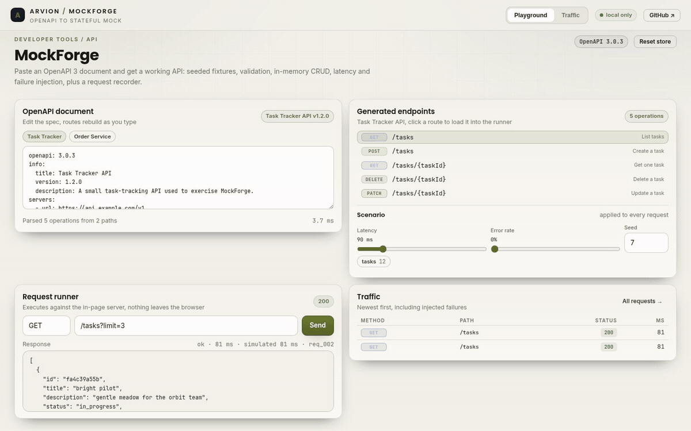
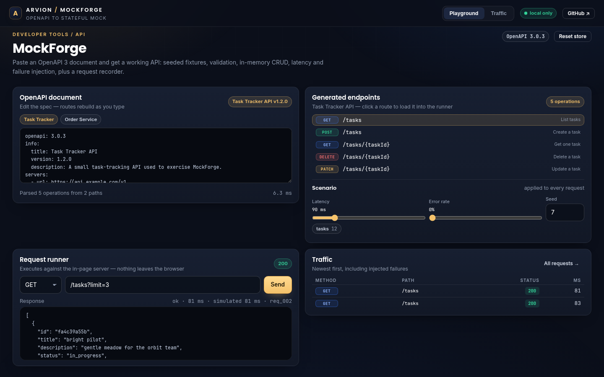

<div align="center">

</div>

<sub>Recorded from the live demo — <a href="docs/demo.mp4">MP4</a> · <a href="docs/screenshot.png">static frame</a></sub>

# MockForge

Turn an OpenAPI 3 document into a running mock API: routes with path, query and
body validation; deterministic fake data from your schemas; an in-memory CRUD
store; latency and failure injection; and a recording of every request. No
dependencies, no build step, no account.

[**Open the live demo**](https://arvion-technology.github.io/labs/demos/mockforge/) · [MIT](LICENSE)

---

Front-end work stalls when the API it needs does not exist yet. The usual
answers are checking in fixtures by hand, or paying for a hosted mock service
that guesses at the contract. MockForge uses the contract you already wrote.
The server, the CLI and the browser playground all run the same modules in
`src/`, so a route that works in the demo behaves the same way over HTTP.

## What it does

- **Serves a spec** — `mockforge serve examples/tasks.yaml --port 4010` starts a
  real HTTP server with CORS enabled and logs the generated routes.
- **Loads YAML or JSON OpenAPI 3** — a small parser in `src/yaml.js` covers the
  subset OpenAPI needs, including flow collections and block strings.
- **Resolves local `$ref`s** — `#/components/schemas/Task` is inlined once and
  cached; circular schemas are marked instead of expanded forever.
- **Generates seeded fixtures** — the same seed returns byte-identical data, so
  a failing front-end test fails for the same reason twice.
- **Validates requests** — path parameters are coerced, query parameters are
  checked against their declared types and enums, and request bodies are
  validated against the JSON Schema with every error reported at once.
- **Keeps state** — POST inserts into the in-memory store, GET by id reads it,
  PATCH merges, DELETE returns 204 and the next GET returns 404.
- **Injects conditions** — per-request latency with jitter, a configurable 500
  error rate, and a rate-limit window.
- **Records traffic** — the last 200 requests with status, duration, query,
  body and response, shown in the demo's Traffic view.

## Screenshots

| Playground | Recorded traffic |
| --- | --- |
|  |  |

## Architecture

```text
 spec.yaml / spec.json
        │
        ▼
 src/yaml.js ──► src/spec.js ──────────────► routes
   parser        parseSpec,                  │
                 createResolver ($ref)       ▼
                                   src/router.js  compile path regexes,
                                      │           validate, shape lists
                    ┌─────────────────┼──────────────────┐
                    ▼                 ▼                  ▼
              src/schema.js      src/fake.js        src/store.js
              validate/coerce    seeded generators  in-memory CRUD
                    └─────────────────┼──────────────────┘
                                      ▼
                                src/server.js
                        handle(request) → response
                         │                     │
                  scripts/cli.mjs        demo/app.js
                  node:http adapter      request runner UI
```

`src/server.js` is a pure function over plain objects. The CLI wraps it in a
`node:http` server; the demo calls it directly. That is why the browser needs no
mock server and the tests need no sockets (except one CLI integration test).

## Quickstart

```bash
git clone https://github.com/arvion-technology/mockforge.git
cd mockforge
npm test                         # 44 tests, no dependencies
node scripts/cli.mjs list examples/tasks.yaml
node scripts/cli.mjs serve examples/tasks.yaml --port 4010 --latency 150
```

Then call it like any other API:

```bash
curl -s localhost:4010/tasks?limit=2
curl -s -X POST localhost:4010/tasks \
  -H 'content-type: application/json' \
  -d '{"title":"Wire the checkout retry","priority":2}'
```

The failure controls are flags, not code changes:

```bash
# 5% of requests fail with a 500, every response waits ~200ms
node scripts/cli.mjs serve examples/tasks.yaml --error-rate 0.05 --latency 200
```

## How it works

**The YAML reader is indentation-driven, not regex-driven.** `parseYaml` strips
comments outside quotes, tokenises lines with their exact indentation, and then
recursively parses either a mapping or a sequence at that indent. A line at the
wrong indent is an error rather than a silent misread. The subset is deliberate:
anchors, aliases, multi-document streams and tags are not supported, and the
loader says so when it meets one.

**Fixtures are seeded from their logical path, not from call order.** Every
generated value hashes a seed string such as `tasks#3/title` and builds its own
`mulberry32` stream. Adding a property to a schema therefore does not shuffle
the values of the properties around it, and two runs with seed 7 produce the
same `Task` list. `src/fake.js` also reads the field name, so `email` gets a
valid email, `createdAt` gets an RFC 3339 timestamp, and `priority` respects the
schema's 1–5 bounds.

**Validation reports everything in one pass.** `validate` returns an array of
`{ path, message }` entries rooted at `$` (`$.title`, `query.limit`,
`$.tags[1]`). A 400 body includes all of them, so a caller does not have to fix
one field, retry and discover the next. Query values arrive as strings and are
coerced before validation: `limit=2` becomes the integer 2, and `limit=500`
fails the declared maximum.

**Wrapped list responses keep their envelope.** A spec whose collection returns
`{ items: [...], total: n }` gets that shape, while a spec returning a bare array
gets an array. `shapeList` picks the envelope by inspecting the declared response
schema, so the mock does not quietly change the contract.

## Tests

```bash
npm test
```

44 `node:test` cases across six files: YAML parsing (nested blocks, flow
collections, comments, block strings, tab rejection), spec loading and `$ref`
resolution (including circular schemas and remote-ref rejection), schema
validation and query coercion, fake-data determinism and schema conformance,
the request handler (seeding, filters, CRUD, 400/404/405, HEAD, rate limits,
injected errors, recorder) and one end-to-end CLI test that starts the server on
an ephemeral port and talks to it over HTTP.

`node scripts/serve-check.mjs` verifies that every demo asset reference
resolves and that no placeholder text ships in the page.

## Limitations

The mock is not a proxy and does not call a real backend. The YAML subset is
smaller than a full YAML parser: no anchors/aliases, and blank lines inside
block strings are collapsed — good enough for OpenAPI documents, not for
arbitrary configuration. Only local `$ref`s resolve, because a mock that needs
the network defeats the point. Request bodies are validated but responses are
not validated against their schema, and the store is a `Map` that disappears
when the process exits or the page reloads. Security schemes, cookies and
multipart bodies are read but not enforced.

## Project layout

```text
mockforge/
├── src/
│   ├── yaml.js      # indentation-driven YAML subset parser
│   ├── spec.js      # OpenAPI loading, $ref resolver, operation listing
│   ├── schema.js    # JSON Schema validation + query coercion
│   ├── fake.js      # seeded schema→data generator
│   ├── router.js    # path compilation, route matching, response shaping
│   ├── store.js     # in-memory collections with deterministic ids
│   ├── server.js    # handle(request) core, scenarios, recorder
│   └── samples.js   # the two specs used by the demo
├── test/            # 44 node:test cases
├── scripts/cli.mjs  # serve | list
├── examples/        # tasks.yaml for the CLI
└── demo/            # static playground, imports ../src directly
```

## Credits

Built by [Arvion Technologies](https://arviontech.net) in Kathmandu as part of
our open-source [Labs](https://github.com/arvion-technology/labs) series. MIT
licensed.
